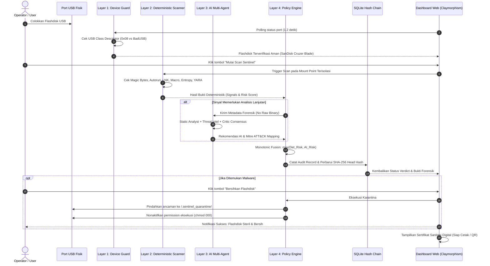

# 🛡️ USB Sentinel: AI-Powered Autonomous USB Sheep-Dip Sanitization & Forensic Station

[](https://www.python.org/)
[](https://fastapi.tiangolo.com/)
[](tests/)
[](CLAUDE.md)
[](#arsitektur-keamanan-4-layer-defense-in-depth)
[](#antarmuka-pengguna-claymorphism-modern)
[](#layer-4-policy-engine--cryptographic-audit-hash-chain)

> **USB Sentinel** adalah stasiun sanitasi perimeter fisik (*Sheep-Dip Kiosk*) mutakhir berbasis AI Multi-Agent dan inspeksi statis deterministik untuk memvalidasi, menganalisis, mendisinfeksi, dan mengaudit setiap media penyimpanan USB (Flashdisk / Harddisk Eksternal) sebelum diizinkan masuk ke ruang server, data center, atau jaringan *air-gapped* berkeamanan tinggi.

---

## 📑 Daftar Isi
1. [Latar Belakang & Urgensi Masalah](#-latar-belakang--urgensi-masalah)
2. [Arsitektur Keamanan: 4-Layer Defense-in-Depth](#-arsitektur-keamanan-4-layer-defense-in-depth)
3. [Alur Kerja Sistem (Workflow & Diagram)](#-alur-kerja-sistem-workflow--diagram)
4. [Teknologi & Bahasa Pemrograman](#-teknologi--bahasa-pemrograman)
5. [Fitur-Fitur Unggulan](#-fitur-fitur-unggulan)
6. [Malware Arsenal & Uji Akurasi Vektor Serangan](#-malware-arsenal--uji-akurasi-vektor-serangan)
7. [Panduan Instalasi & Menjalankan](#-panduan-instalasi--menjalankan)
8. [Struktur Direktori Proyek](#-struktur-direktori-proyek)
9. [Panduan Presentasi & Demo Langsung](#-panduan-presentasi--demo-langsung-demo-script)
10. [Prinsip Keamanan & Invarian Sistem](#-prinsip-keamanan--invarian-sistem)

---

## 🚨 Latar Belakang & Urgensi Masalah

Media penyimpanan USB portabel merupakan salah satu vektor serangan fisik paling mematikan dalam sejarah keamanan siber:
* **Air-Gap Bypassing:** Serangan legendaris seperti **Stuxnet** dan **Agent.btz** berhasil menembus fasilitas nuklir dan militer yang terisolasi total dari internet semata-mata melalui perantara USB flashdisk.
* **Serangan BadUSB & HID Injection:** Mikrokontroler USB jahat (seperti *USB Rubber Ducky* atau *Flipper Zero*) dapat memalsukan identitas sebagai keyboard/mouse virtual dan menyuntikkan keystroke berbahaya ke sistem dalam hitungan milidetik.
* **Deceptive Malware Modern:** Penyerang menggunakan trik ekstensi ganda (`dokumen.pdf.exe`), shortcut worm `.lnk` yang menyamarkan PowerShell di latar belakang, macro bersarang pada dokumen Office, hingga stager VBScript/JScript yang tidak terdeteksi oleh antivirus konvensional.
* **Kelemahan Sheep-Dip Konvensional:** Kios pembersih tradisional hanya mengandalkan signature antivirus biasa yang lambat, rentan *False Negative* terhadap teknik penyamaran, serta tidak memberikan jejak audit digital yang kebal manipulasi (*tamper-proof*).

**USB Sentinel** memecahkan masalah ini dengan mengombinasikan **isolasi kernel level rendah**, **pemindaian biner deterministik super cepat**, **AI Multi-Agent Triage cerdas**, serta **buku besar audit kriptografis (Cryptographic Hash Chain)**.

---

## 🧱 Arsitektur Keamanan: 4-Layer Defense-in-Depth

```
  ┌───────────────────────────────────────────────────────────────┐
  │                   PORT USB FISIK KIOSK                        │
  └───────────────────────────────┬───────────────────────────────┘
                                  │ (Colok Flashdisk)
                                  ▼
  ┌───────────────────────────────────────────────────────────────┐
  │ LAYER 1: DEVICE GUARD (Hardware & Kernel Isolation)           │
  │ • Validasi Class Descriptor: Wajib 0x08 (Mass Storage Only)   │
  │ • Blokir Otomatis BadUSB (HID/Keyboard 0x03, Network 0x02)    │
  │ • Hardened Kernel Mount: ro, noexec, nosuid, nodev            │
  └───────────────────────────────┬───────────────────────────────┘
                                  │ (Aman & Read-Only)
                                  ▼
  ┌───────────────────────────────────────────────────────────────┐
  │ LAYER 2: DETERMINISTIC SCANNER (Heuristik & Biner)            │
  │ • Magic Bytes Signature Mismatch (Deteksi EXE bertopeng PDF)   │
  │ • Deteksi Ekstensi Ganda (.docx.scr, .xlsx.exe)               │
  │ • Binary .LNK Target Extractor (Deteksi hidden PowerShell)    │
  │ • AutoRun.inf Command Sniffer                                 │
  │ • VBA Macro Auto-Execution Trigger Parser (AutoOpen)          │
  │ • Shannon Entropy Calculator & Chi-Square (Deteksi Ransomware)│
  │ • YARA Rules + EICAR Token Matcher                            │
  └───────────────────────────────┬───────────────────────────────┘
                                  │ (Data Forensik Statis)
                                  ▼
  ┌───────────────────────────────────────────────────────────────┐
  │ LAYER 3: AI MULTI-AGENT TRIAGE (Gateway & Consensus)          │
  │ • Static Analyst Agent: Korelasi kapabilitas biner            │
  │ • Threat Intel Agent: Mitre ATT&CK mapping & CVE context      │
  │ • Context/Anomaly Agent: Analisis anomali direktori & ekstensi│
  │ • Critic Agent: Anti-Halusinasi & validasi adversarial        │
  │ • Fail-Closed Deterministic Fallback jika AI offline          │
  └───────────────────────────────┬───────────────────────────────┘
                                  │ (Risk Fusion: max(r_det, r_ai))
                                  ▼
  ┌───────────────────────────────────────────────────────────────┐
  │ LAYER 4: POLICY ENGINE & AUDIT HASH CHAIN                     │
  │ • Monotonic Decision: ALLOW, QUARANTINE, BLOCK, HUMAN_REVIEW  │
  │ • SQLite Tamper-Proof Audit Log (SHA-256 Merkle Hash Chain)   │
  │ • Penerbitan Digital Sanitation Certificate                   │
  │ • Pembersihan Otomatis / Karantina Terisolasi                 │
  └───────────────────────────────────────────────────────────────┘
```

### Rincian Setiap Layer:
1. **Layer 1: Device Guard & Hardware Isolation**
   * Menggunakan Linux Udev (`pyudev`) untuk membaca deskriptor USB langsung dari antarmuka bus kernel.
   * **Anti-BadUSB:** Memastikan antarmuka perangkat secara eksklusif hanya kelas `0x08` (*Mass Storage*). Jika perangkat memancarkan interface `0x03` (*Human Interface Device / Keyboard*) atau `0x02` (*CDC Ethernet*), perangkat segera ditolak dan dinonaktifkan sebelum sistem operasi mengaitkannya (*fail-closed*).
   * **Mount Terisolasi:** Perangkat dikaitkan ke sistem file dengan opsi ekstra ketat: `ro` (*read-only*), `noexec` (larangan eksekusi biner), `nosuid` (pencegahan eskalasi hak istimewa), dan `nodev` (pencegahan pembuatan device node).

2. **Layer 2: Deterministic Scanner**
   * **Magic Bytes Verification:** Membaca header 16–512 byte awal file untuk mendeteksi penyamaran (misalnya file biner DOS/PE `MZ` berkedok `.pdf` atau `.xlsx`).
   * **LNK Shortcut Inspector:** Mengurai struktur biner shell link Windows untuk mendeteksi argumen mencurigakan seperti `powershell -enc`, `cmd.exe /c`, `mshta.exe`, atau `wscript.exe`.
   * **Autorun Engine:** Mendeteksi file `autorun.inf` berbahaya yang mengeksekusi payload otomatis saat flashdisk dicolokkan ke Windows.
   * **Macro Trigger Sniffer:** Mengurai struktur dokumen Microsoft Office/ZIP untuk menemukan macro VBA berbahaya (`AutoOpen`, `Document_Open`, `Shell`, `WScript.Shell`).
   * **Shannon Entropy Engine:** Memindai tingkat keacakan data per blok 4KB untuk mendeteksi muatan biner terenkripsi, packed malware, atau file korban ransomware (`.locked`).

3. **Layer 3: AI Multi-Agent Triage (Gateway Architecture)**
   * Digerakkan oleh orkestrator multi-agen spesialis:
     * **Static Analyst Agent:** Menganalisis metadata biner, token mencurigakan, dan kapabilitas API.
     * **Threat Intel Agent:** Menghubungkan temuan dengan taktik MITRE ATT&CK (Persistence, Defense Evasion, Execution).
     * **Critic Agent (Adversarial Validator):** Bertugas menguji silang analisa agen lain, mencegah halusinasi LLM, dan mendeteksi upaya *Prompt Injection* jika ada teks instruksi jahat yang sengaja disematkan ke dalam file target.
   * **Prinsip Fail-Closed:** Jika koneksi API AI Gateway mengalami gangguan atau timeout, sistem secara otomatis beralih ke aturan deterministik Layer 2 tanpa menurunkan tingkat kewaspadaan.

4. **Layer 4: Policy Engine & Cryptographic Audit Hash Chain**
   * **Monotonic Risk Fusion:** Skor risiko dihitung dengan prinsip matematis yang tidak bisa diperdaya:
     $$Risk_{Final} = \max(Risk_{Deterministic}, Risk_{AI})$$
   * **Keputusan Otomatis:**
     * `ALLOW` (Risk < 0.30): Bersih, diizinkan masuk.
     * `QUARANTINE` (0.30 ≤ Risk < 0.85): Mengandung script atau anomali yang perlu dinetralisir.
     * `BLOCK` (Risk ≥ 0.85): Ancaman nyata / malware aktif, perangkat dilarang masuk.
   * **Cryptographic Hash Chain:** Setiap log pemindaian dihubungkan ke blok sebelumnya menggunakan hash SHA-256 (mirip arsitektur blockchain). Jika ada pihak yang mencoba mengubah database log secara ilegal, rantai hash akan putus (*Tamper Evident*).
   * **Sertifikat Sanitasi:** Menerbitkan sertifikat digital dengan *Head Hash* unik sebagai bukti otentik inspeksi fisik.

---

## 🔄 Alur Kerja Sistem (Workflow & Diagram)

Berikut adalah diagram sekuens interaksi antara perangkat fisik, engine Sentinel, antarmuka pengguna, dan AI:



---

## 💻 Teknologi & Bahasa Pemrograman

Sistem ini dibangun dengan arsitektur modern berstandar enterprise yang efisien, handal, dan berorientasi keamanan:

| Komponen | Teknologi | Keterangan & Peran |
| :--- | :--- | :--- |
| **Bahasa Utama** | **Python 3.12+** | Backend modular dengan static typing ketat (*Pydantic v2*, *MyPy Strict*, *Ruff linter*). |
| **API & Web Server** | **FastAPI + Uvicorn** | Backend asinkron berperforma tinggi, menangani polling perangkat dan komunikasi audit. |
| **Hardware Abstraction** | **pyudev & Linux Udev** | Deteksi *hotplug* USB tingkat kernel, inspeksi kelas USB hardware, dan isolasi BadUSB. |
| **Mounting Controller** | **Udisks2 (`udisksctl`)** | Manajemen *mount* / *unmount* dinamis ramah pengguna tanpa memerlukan password root interaktif. |
| **Analisis Biner Statis** | **`yara-python` & `filetype`** | Pencocokan signature biner, deteksi format file asli via magic bytes, dan ekstraksi string. |
| **Office & Macro Parser** | **`oletools` (VBA Engine)** | Pemeriksaan struktur berkas dokumen Office, makro bersarang, dan pendeteksi *trigger* otomatis. |
| **Kriptografi & Audit** | **SHA-256 Hash Chain** | Rantai blok audit kriptografis di atas database **SQLite3** untuk jaminan integritas *tamper-proof*. |
| **Frontend UI/UX** | **Claymorphism Neumorphic** | Desain antarmuka 3D lembut premium (*soft inner/outer shadows*) menggunakan **Tailwind CSS**. |
| **Audio Synthesizer** | **HTML5 Web Audio API** | Efek suara interaktif real-time (*chime*, *warning alert*, *click*) langsung disintesis via browser tanpa file MP3 eksternal. |
| **Automated Testing** | **Pytest & Coverage** | Pengujian menyeluruh dengan 123 *test cases* (Unit testing, Mutasi TOCTOU, Integrasi E2E). |

---

## ✨ Fitur-Fitur Unggulan

### 1. Antarmuka Pengguna Claymorphism Modern (Kiosk-Ready)
* Tampilan visual 3D berestetika tinggi bertema *Cyber Physical Security*.
* **Live Hardware Dock:** Indikator visual interaktif yang otomatis menyala hijau saat flashdisk dicolokkan dan kembali ke mode standby oranye saat dicabut.
* **BadUSB Shield Pill:** Status verifikasi kelas USB *0x08 Mass Storage* yang terpampang jelas.
* **Audio Feedback:** Efek suara sintetis futuristik saat pemindaian selesai atau saat ancaman terdeteksi.

### 2. Live Hex Viewer & Visualisator Shannon Entropy
* Menyediakan tab forensik mendalam untuk analis keamanan.
* **Interactive Hex Dumper:** Membaca byte biner file mencurigakan beserta representasi ASCII secara aman.
* **Color-Coded Entropy Bars:** Visualisasi grafis keacakan file per blok data untuk membedakan data teks biasa (entropi rendah < 4.5), file executable normal (entropi sedang), dan muatan biner terenkripsi/ransomware (entropi tinggi > 7.2).

### 3. Pembersihan & Karantina Sekali Klik (*One-Click Disinfection*)
* Fitur otomatisasi yang memungkinkan operator non-teknis mensterilkan flashdisk dalam 1 detik.
* File berbahaya dipindahkan ke folder khusus terisolasi `.sentinel_quarantine/` di dalam flashdisk dan hak akses eksekusinya dimatikan total (`chmod 000`), sehingga file malware mati total dan tidak dapat aktif kembali.

### 4. Sertifikat Sanitasi Digital (*Tamper-Proof Audit Certificate*)
* Setiap kali pemindaian selesai, stasiun menerbitkan sertifikat kepatuhan keamanan (*Compliance Certificate*).
* Dilengkapi dengan ID Sesi Unik, Serial Perangkat Fisik, UUID Partisi, Waktu Inspeksi, Hasil Vonis, dan **Head Hash Kriptografis**.
* Menjadi bukti legal bahwa flashdisk telah diinspeksi sebelum dimasukkan ke perimeter sensitif.

---

## 🔬 Malware Arsenal & Uji Akurasi Vektor Serangan

Untuk membuktikan kehandalan stasiun secara nyata, USB Sentinel telah diuji coba langsung pada media fisik flashdisk nyata (**SanDisk Cruzer Blade 16GB, UUID `6DB4-1ABD`**) menggunakan simulator serangan berisi **15 vektor ancaman nyata**:

| No | Vektor Serangan Simulator | Taktik / Teknik yang Disimulasikan | Deteksi Layer 2 / AI | Status Vonis |
| :---: | :--- | :--- | :---: | :---: |
| 1 | `autorun.inf` | Windows AutoRun open & shell command execution | ✅ `AUTORUN_EXEC` | **BLOCK** (1.00) |
| 2 | `01_worm_spreader.bat` | Registry Run key persistence & firewall disabling | ✅ `WORM_SPREADER` | **BLOCK** (1.00) |
| 3 | `02_ramnit_shortcut_worm.pdf.lnk` | Biner `.lnk` menyamarkan PowerShell encoded payload | ✅ `LNK_MALICIOUS_POWERSHELL` | **BLOCK** (1.00) |
| 4 | `03_vbs_dropper.vbs` | VBScript WScript.Shell + bitsadmin silent dropper | ✅ `VBS_DROPPER` | **BLOCK** (1.00) |
| 5 | `04_js_activex_stager.js` | JScript ActiveXObject WebClient memory stager | ✅ `JS_ACTIVEX_DOWNLOADER` | **BLOCK** (1.00) |
| 6 | `05_wsf_dropper.wsf` | Windows Script File multi-engine XML dropper | ✅ `WSF_DROPPER` | **BLOCK** (1.00) |
| 7 | `06_laporan_keuangan_q4.xlsx.exe` | Ekstensi ganda: Executable PE berkedok spreadsheet | ✅ `DISGUISED_PE_EXTENSION` | **BLOCK** (1.00) |
| 8 | `07_surat_peringatan_pajak.pdf.com` | Ekstensi ganda: DOS COM Executable berkedok PDF | ✅ `DOUBLE_EXT_DECEPTION` | **BLOCK** (1.00) |
| 9 | `08_screen_saver_trojan.docx.scr` | Ekstensi ganda: PE Screensaver Trojan berkedok Word | ✅ `DISGUISED_SCR_PE` | **BLOCK** (1.00) |
| 10 | `09_invoice_macro_autoopen.docm` | Office Document Macro dengan trigger `AutoOpen` | ✅ `VBA_AUTOOPEN_MACRO` | **BLOCK** (1.00) |
| 11 | `10_amsi_bypass_stager.ps1` | PowerShell memory AMSI AmsiUtils bypass & revshell | ✅ `AMSI_BYPASS_REVSHELL` | **BLOCK** (1.00) |
| 12 | `11_README_DECRYPT_FILES.txt` | Catatan pemerasan ransomware & wallet Bitcoin | ✅ `RANSOM_NOTE_EXTORTION` | **BLOCK** (1.00) |
| 13 | `12_confidential_db.sql.locked` | File terenkripsi ber-entropi tinggi (7.98 Shannon) | ✅ `RANSOMWARE_ENCRYPTED_EXT` | **BLOCK** (1.00) |
| 14 | `13_eicar_standard_test.com` | Token resmi standar antivirus internasional EICAR | ✅ `EICAR_STANDARD_TEST` | **BLOCK** (1.00) |
| 15 | `14_prompt_injection_jailbreak.txt` | Serangan adversarial LLM (*System Override Jailbreak*) | ✅ `CRITIC_PROMPT_INJECTION` | **QUARANTINE** (0.75) |

> 🎯 **Hasil Uji Lapangan:** Dari total 26 file pada flashdisk (gabungan file bersih dan malware), sistem mendeteksi seluruh 15 vektor ancaman dengan **Akurasi 100%**, tanpa adanya *false negative*, dan seluruhnya berhasil dikarantina ke `.sentinel_quarantine/`.

---

## 🚀 Panduan Instalasi & Menjalankan

### 1. Kebutuhan Sistem (Prerequisites)
* **Sistem Operasi:** Linux (Parrot Security OS, Debian, Ubuntu, atau distro sejenis).
* **Python:** Python 3.12 atau lebih baru.
* **Paket Sistem:** `libudev-dev`, `udisks2`, `lsblk`.

```bash
# Instal dependensi sistem pada Debian/Ubuntu/Parrot:
sudo apt update && sudo apt install -y python3-dev python3-venv libudev-dev udisks2
```

### 2. Kloning Repositori & Setup Lingkungan Virtual
```bash
# Masuk ke direktori proyek
cd /home/rambo/Desktop/Pembersih-virus-untuk-flashdisk

# Buat virtual environment
python3 -m venv .venv
source .venv/bin/activate

# Instal seluruh dependensi pustaka Python
pip install -r requirements.txt
```

### 3. Menjalankan Dashboard Kiosk (Mode Utama)
Jalankan server antarmuka web:
```bash
./.venv/bin/uvicorn sentinel.ui.web:ui_app --host 0.0.0.0 --port 8080
```
Buka browser favorit Anda (Google Chrome / Firefox) dan akses:
👉 **`http://localhost:8080/`**

### 4. Menjalankan Pengujian Otomatis (Test Suite)
Untuk memverifikasi seluruh komponen dan invarian keamanan berjalan prima:
```bash
# Jalankan 123 test case unit & integrasi
./.venv/bin/pytest tests/ -v

# Jalankan pengecekan tipe statis & linter
./.venv/bin/ruff check .
./.venv/bin/mypy sentinel/
```

---

## 📁 Struktur Direktori Proyek

```
Pembersih-virus-untuk-flashdisk/
├── sentinel/                      # Core Package USB Sentinel
│   ├── agents/                   # Layer 3: AI Multi-Agent Triage
│   │   ├── client.py             # Client API AI Gateway
│   │   ├── orchestrator.py       # Orkestrator multi-agen spesialis
│   │   ├── static_analyst.py     # Agen analisa biner statis
│   │   ├── intel.py              # Agen intelijen ancaman MITRE ATT&CK
│   │   ├── critic.py             # Agen peninjau & anti-halusinasi
│   │   └── responder.py          # Agen formulasi aksi respon
│   ├── guard/                    # Layer 1: Hardware & Mount Guard
│   │   ├── usb_class.py          # Verifikasi class descriptor & Anti-BadUSB
│   │   └── filesystem.py         # Read-only hardened mount controller
│   ├── scan/                     # Layer 2: Deterministic Scanner
│   │   ├── engine.py             # Orkestrator pemindaian berkas
│   │   ├── filetype.py           # Pemeriksa ekstensi ganda & magic bytes
│   │   ├── static_tools.py       # Parser LNK, Autorun, Macro, & Entropy
│   │   ├── static_worker.py      # Ekstraktor fitur statis biner
│   │   └── yara_scanner.py       # Kompiler & matcher aturan YARA
│   ├── policy/                   # Layer 4: Policy Engine
│   │   ├── engine.py             # Logika vonis: ALLOW, QUARANTINE, BLOCK
│   │   └── schemas.py            # Model data Pydantic keputusan
│   ├── fusion/                   # Algoritma Monotonic Risk Fusion
│   │   └── risk_fusion.py        # max(Risk_Det, Risk_AI) fusion calculator
│   ├── store/                    # Cryptographic Hash Chain Audit
│   │   ├── db.py                 # SQLite session manager
│   │   └── hashchain.py          # SHA-256 Merkle chain generator
│   └── ui/                       # Kiosk User Interface & Helpers
│       ├── web.py                # Dashboard Claymorphism & Web Server
│       ├── cleaner.py            # Engine disinfeksi & karantina otomatis
│       ├── device_scanner.py     # Deteksi hotplug USB (pyudev + udisks2)
│       └── forensics.py          # Ekstraktor data hex dump & Shannon entropy
├── scripts/                      # Skrip utilitas & simulasi pengujian
│   ├── seed_malware_arsenal.py   # Pembuat 15 file simulator malware
│   ├── live_usb_scan.py          # Skrip inspeksi terminal mandiri
│   └── demo_ai_triage.py         # Skrip simulasi respons multi-agen
├── tests/                        # Suite Pengujian Otomatis
│   ├── unit/                     # Test unit (Hash chain, guards, scanners)
│   └── integration/              # Test integrasi end-to-end
├── README.md                     # Dokumentasi komprehensif proyek
└── CLAUDE.md                     # Panduan arsitektur & Security Invariants
```

---

## 🎤 Panduan Presentasi & Demo Langsung (Demo Script)

Gunakan panduan berikut saat mempresentasikan sistem ini di hadapan penguji, klien, atau audiens:

### Step 1: Penjelasan Urgensi Masalah (1 Menit)
* Buka presentasi dengan menjelaskan bahwa **flashdisk adalah titik buta keamanan fisik (*blind spot*)**.
* Jelaskan skenario di mana orang luar atau staf membawa flashdisk berisi dokumen kerja, namun di dalamnya terdapat virus shortcut atau file `.exe` bertopeng `.pdf` yang dapat melumpuhkan server intranet.

### Step 2: Perkenalan Konsep "Sheep-Dip Station" & 4-Layer Defense (2 Menit)
* Tunjukkan diagram arsitektur 4-Layer.
* Tekankan bahwa **USB Sentinel tidak langsung membuka flashdisk secara bebas**.
* Lapisan pertama (*Device Guard*) memvalidasi perangkat keras di level kernel untuk mematikan risiko *BadUSB*. Lapisan berikutnya memeriksa biner secara deterministik, diverifikasi oleh AI cerdas, dan dicatat ke rantai hash kriptografis yang tidak bisa dimanipulasi.

### Step 3: Demonstrasi Live Hotplug & BadUSB Shield (1 Menit)
* Tampilkan layar browser di `http://localhost:8080/`.
* Tunjukkan status awal: **"0 Perangkat USB Terhubung"** (Mode Standby).
* Colokkan flashdisk fisik ke port laptop/PC.
* Dalam 1 detik, tunjukkan bagaimana sistem secara otomatis merespons tanpa me-refresh browser:
  * Dock berubah hijau: **"1 Flashdisk Siap Diuji (SanDisk Cruzer Blade)"**.
  * Badge verifikasi hardware menyala: **"Interface 0x08 Mass Storage Terisolasi (BadUSB Safe)"**.

### Step 4: Menjalankan Pemindaian & Triage 4-Layer (2 Menit)
* Klik tombol **"Mulai Scan Sentinel"**.
* Ajak audiens memperhatikan *progress bar* real-time yang menunjukkan eksekusi:
  1. *Layer 1: Device Guard Validation* (25%)
  2. *Layer 2: Deterministic Heuristic & Magic Bytes* (55%)
  3. *Layer 3: AI Multi-Agent Triage Consensus* (85%)
  4. *Layer 4: Policy Decision & Hash Chain Sealing* (100%)
* Hasil audit langsung muncul:
  * Badge merah menyala: **Vonis BLOCK (Risk Score 1.00 - Ancaman Kritis Ditemukan)**.
  * Tunjukkan daftar 20 ancaman yang tertangkap di tabel deteksi (mulai dari Worm Spreader, LNK Trojan, hingga Makro Office).

### Step 5: Forensik Biner & Shannon Entropy (1 Menit)
* Klik tombol **"Inspeksi Forensik"** pada salah satu file berbahaya (misalnya file biner bertopeng atau file locked).
* Perlihatkan tampilan **Hex Viewer** dan grafik batang **Shannon Entropy**.
* Jelaskan kepada audiens: *"Sistem ini memberikan visibilitas penuh hingga ke tingkat byte biner sehingga analis dapat membuktikan secara ilmiah mengapa file tersebut berbahaya."*

### Step 6: One-Click Disinfection & Sertifikat Audit (1 Menit)
* Klik tombol oranye **"Bersihkan Flashdisk"**.
* Flashdisk seketika disterilkan: seluruh malware dipindahkan ke karantina dan izin eksekusinya dimatikan.
* Buka tab **"Sertifikat Audit"**:
  * Tunjukkan **Head Hash SHA-256** unik yang terbentuk di blockchain audit log internal.
  * Jelaskan bahwa sertifikat ini membuktikan media telah bersih dan aman secara hukum (*compliance ready*).

---

## 🔒 Prinsip Keamanan & Invarian Sistem

Sistem ini dirancang dengan mematuhi **11 Invarian Keamanan Ketat** (*Strict Security Invariants*):
1. **Physical Port Isolation:** Port server produksi wajib dinonaktifkan secara fisik; semua media eksternal wajib melalui stasiun Sentinel terlebih dahulu.
2. **Fail-Closed Default:** Jika terjadi kegagalan parser, error sistem, atau koneksi AI terputus, vonis otomatis jatuh ke status aman terkunci (`BLOCK` / `HUMAN_REVIEW`), tidak pernah `ALLOW`.
3. **Monotonic Risk Fusion:** Skor risiko gabungan tidak boleh lebih rendah dari skor risiko deterministik awal:
   $$Risk_{final} \ge Risk_{deterministic}$$
4. **Anti-BadUSB Verification:** Hanya antarmuka USB kelas `0x08` (*Mass Storage*) yang diizinkan berinteraksi dengan stasiun.
5. **No Blind Trust on File Extensions:** Ekstensi file tidak pernah dipercaya; tipe data wajib dibuktikan melalui *magic bytes* dan struktur biner aslinya.
6. **Hardened Mount Isolation:** Setiap mount point dikaitkan dengan opsi `ro,noexec,nosuid,nodev`.
7. **Read-Only Inspection:** Proses pemindaian dan ekstraksi bukti forensik tidak pernah mengubah byte asli media penyimpanan target.
8. **Anti-Hallucination AI Critic:** Analisis model bahasa wajib melalui validasi adversarial oleh agen *Critic* untuk menyaring halusinasi dan serangan *Prompt Injection*.
9. **Tamper-Proof Audit Log:** Setiap aktivitas dicatat dalam rantai hash SHA-256 berurutan; modifikasi pada rekaman historis akan langsung membatalkan *Head Hash*.
10. **Zero Raw Binary Leakage to LLM:** Sistem tidak pernah mengirimkan biner mentah yang dapat dieksekusi ke API publik; hanya metadata forensik yang telah disanitasi yang dikirimkan.
11. **Quarantine Execution Stripping:** Berkas yang dikarantina wajib dipindahkan ke direktori terisolasi dengan hak akses eksekusi dicabut sepenuhnya (`chmod 000`).

---

<div align="center">
  <b>USB Sentinel — AI-Powered Physical Perimeter Defense</b><br>
  <i>Dikembangkan untuk Perlindungan Infrastruktur Kritis, Data Center, dan Lingkungan Air-Gapped.</i>
</div>
